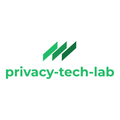

  
  
  
  
  
  
  
  
  
  

# GPC AI Agents Prototypes

The GPC AI Agent Prototypes are developed and maintained by the [OptMeowt team](https://github.com/privacy-tech-lab/gpc-optmeowt#optmeowt-).

This repo contains experimental prototypes exploring how the [Global Privacy Control (GPC) signal](https://globalprivacycontrol.org/) propagates and is enforced across multi-agent AI pipelines. Each prototype simulates a realistic agentic workflow and tests a specific question: does the user's privacy preference actually stop data from being shared, or does it only carry the signal forward and leave enforcement to whoever is downstream?

[1. Prototypes](#1-prototypes)  
[2. Contributing](#2-contributing)  
[3. Thank You!](#3-thank-you)

## 1. Prototypes

| Prototype | Folder                     | What it shows                                                       |
| --------- | -------------------------- | ------------------------------------------------------------------- |
| 1         | [prototype-1](prototype-1) | Tool-level blocking via an MCP interceptor                          |
| 2         | [prototype-2](prototype-2) | Purpose-based gating of secondary pipelines after the agent answers |
| 3         | [prototype-3](prototype-3) | Per-call consent checks for tools added after signup                |
| 4         | [prototype-4](prototype-4) | Signal propagation and the provider visibility gap                  |
| 5         | [prototype-5](prototype-5) | Inference firewall for derived attributes                           |
| 6         | [prototype-6](prototype-6) | Collection gates for input, behavior, and derived data              |
| 7         | [prototype-7](prototype-7) | Retention limits at session end, recall, and profile synthesis      |
| 8         | [prototype-8](prototype-8) | Delegation tiers with a decline-by-default fallback                 |

## 2. Contributing

See [CONTRIBUTING.md](CONTRIBUTING.md) for the issue template, PR conventions, and the writing rules we use across this repo.

## 3. Thank You!

<strong>We would like to thank our supporters!</strong>
 

Major financial support provided by the National Science Foundation under awards <a href="https://nsf.gov/awardsearch/showAward?AWD_ID=2055196">#2055196</a> and <a href="https://www.nsf.gov/awardsearch/show-award/?AWD_ID=2618248">#2618248</a>.

   

Additional financial support provided by Wesleyan University and the Anil Fernando Endowment.

  

Conclusions reached or positions taken are our own and not necessarily those of our financial supporters, its trustees, officers, or staff.

##

  

