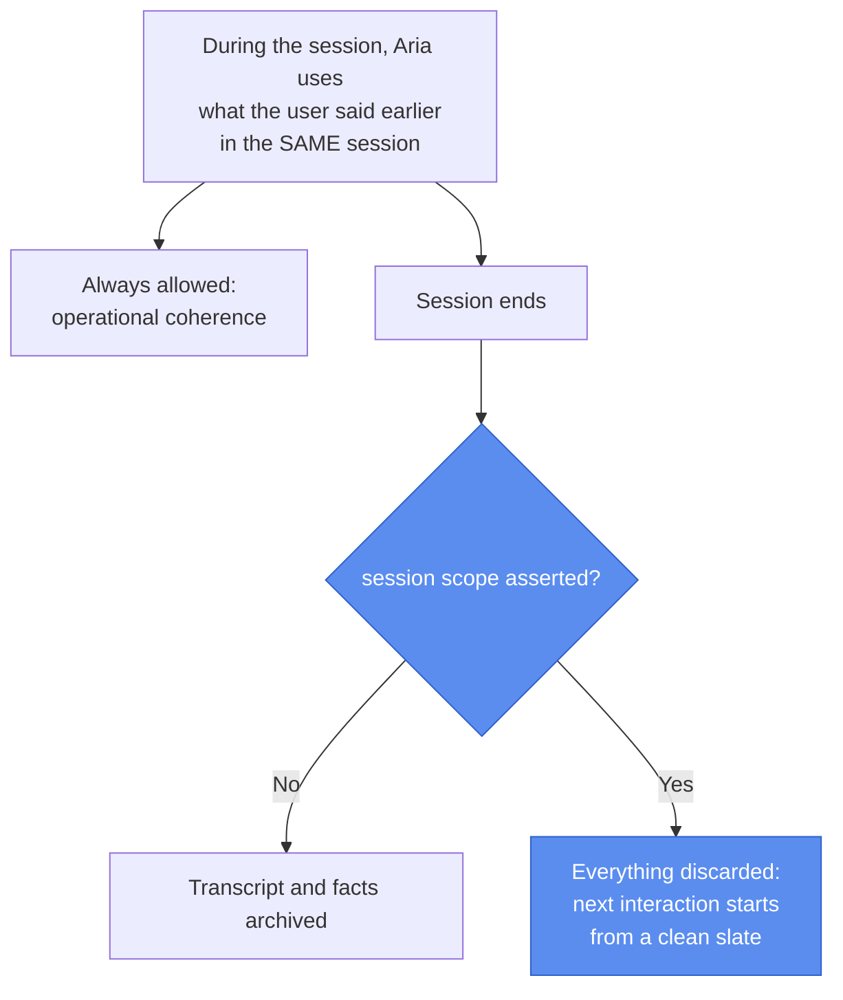
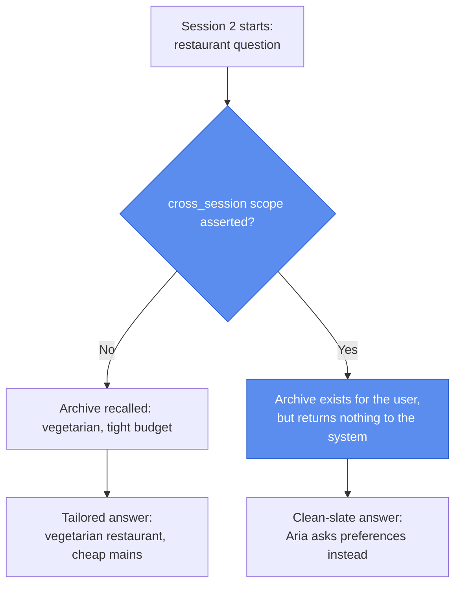
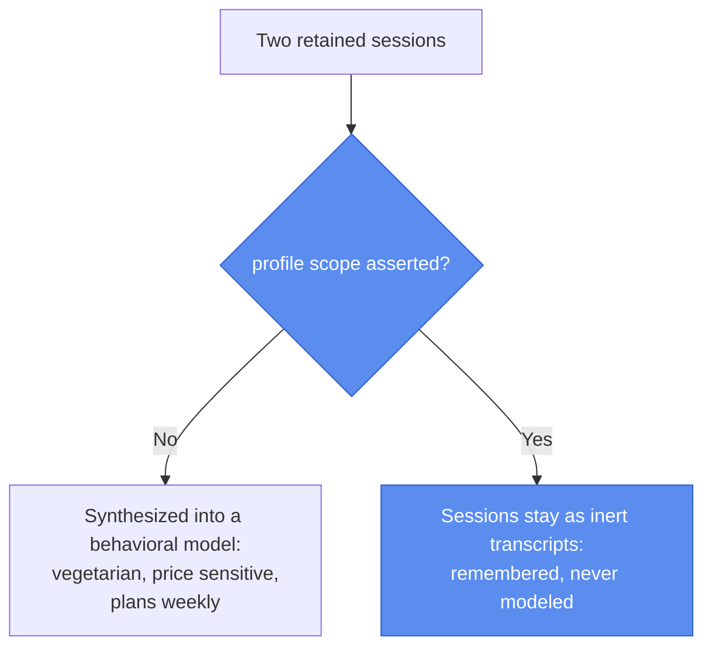

# Prototype 7: Persistence
Note: We use Global Privacy Control (GPC) to demonstrate a potential mechanism of opt-out in this prototype.

Opting out of how long data survives.

This prototype has three persistence scopes:

| Scope | Governs | In this prototype |
|-------|---------|-------------------|
| `session` | Nothing persists once the interaction ends. Within-session use is permitted for operational coherence; every new interaction starts clean. | The session-end boundary: transcripts and disclosed facts are discarded instead of archived. |
| `cross_session` | Within-session retention is permitted, but past interactions may not inform future ones. The user keeps their history; the system may not use it for continuity. | The session-start recall: the archive exists but returns nothing to the new session. |
| `profile` | Retention is permitted, but no behavioral model may be synthesized across time. | The profile synthesis step: sessions stay as inert transcripts. |

The scopes form a hierarchy: asserting `session` implies `cross_session` and `profile`, and asserting `cross_session` implies `profile`. A bare GPC signal asserts the strictest scope (`session`).

## Scenario

A user talks to Aria, a memory-enabled assistant, across two sessions. In session 1 they mention being vegetarian on a tight budget while asking for dinner recipes; Aria's second answer in that session uses those facts, and that same-session coherence works in every mode, including `session`. When session 1 ends, the session boundary decides whether anything survives. When session 2 opens with a restaurant question, the cross-session boundary decides whether session 1 may inform it: the answer is a tailored vegetarian suggestion if recall is permitted and a clean-slate question if not. Afterward, the profile boundary decides whether the archive is compressed into a durable behavioral profile.

## Session scope flow



## Cross-session scope flow



## Profile scope flow



## How enforcement works

Every retention moment goes through [persistence_gate.js](persistence_gate.js):

1. `resolveScope()` expands the hierarchy: `session` implies `cross_session` and `profile`, `cross_session` implies `profile`; bare GPC asserts `session`.
2. `endSession()` is the session boundary. It clears the transient session context in every mode, then archives or discards the transcript.
3. `recallForSession()` is the cross-session boundary. It merges facts from archived sessions or refuses, reporting how many archived sessions were present but withheld.
4. `synthesizeProfile()` is the profile boundary. It writes the behavioral model, refuses to, or reports there was nothing retained to synthesize.

Within-session context is never gated. That is the operational coherence the `session` scope explicitly permits.

## Setup

```bash
npm install
```

The scripted paths need nothing else. The live agent path needs Ollama running locally (`ollama serve`, `ollama pull qwen2.5:14b`; override with `OLLAMA_MODEL`).

## Demo

| Command | What it shows |
|---------|---------------|
| `npm run baseline` | Both sessions archived, session 2 tailored from session 1, profile synthesized. |
| `npm run optout:session` | Nothing survives either session end. Session 2 starts clean. Turn 2 of session 1 is still identical to baseline. |
| `npm run optout:cross_session` | The archive keeps both sessions for the user, but recall returns nothing and synthesis is blocked through the implication. |
| `npm run optout:profile` | Recall still tailors session 2; only the profile synthesis is refused. |
| `npm run optout:full` | Bare GPC behaves as `session`. |
| `npm run demo` | Baseline plus each scope in sequence. |

Live agent versions (a real model plays Aria in session 2; the gate decides what it may remember):

```bash
npm run agent                # recall works: tailored suggestion
npm run agent:cross_session  # recall refused: the model must ask preferences
npm run agent:session        # nothing was archived at all
```

## Tests

```bash
npm test
```

The suites cover the hierarchy resolution, each boundary (including the always-cleared session context and the empty-archive cases), full two-session runs in every scope, and the recall tool boundary.

## What it prevents

Data outliving its moment: transcripts surviving a session end (`session`), past sessions steering new ones (`cross_session`), and retained history hardening into a durable model of the user (`profile`).
