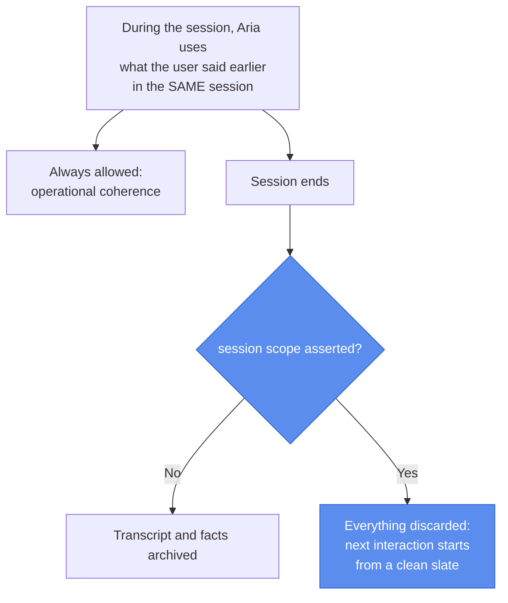
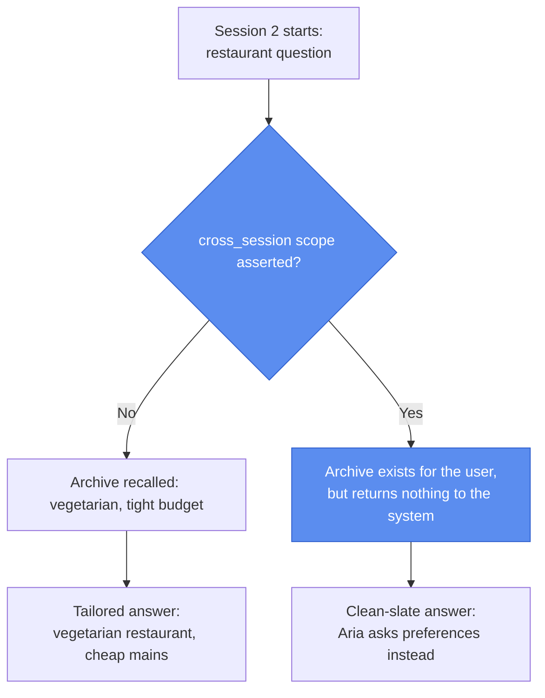
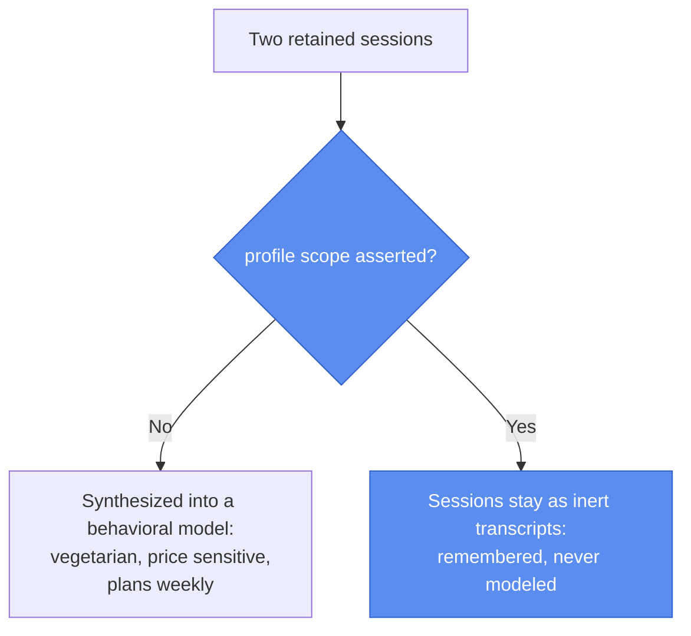

# Prototype 7: Retention
Note: We use Global Privacy Control (GPC) to demonstrate a potential mechanism for sending privacy signals in this prototype.

## What it demonstrates

A user talks to Aria, a memory-enabled assistant, across two sessions. In session 1 they mention being vegetarian on a tight budget while asking for dinner recipes; Aria's second answer in that session uses those facts, and that same-session coherence works in every mode, including `session`. When session 1 ends, the session boundary decides whether anything survives. When session 2 opens with a restaurant question, the cross-session boundary decides whether session 1 may inform it: the answer is a tailored vegetarian suggestion if recall is permitted and a clean-slate question if not. Afterward, the profile boundary decides whether the archive is compressed into a durable behavioral profile.

Prototype 7 lets the user set a retention preference for how long data survives. It prevents data from outliving its moment: transcripts surviving a session end (`session`), past sessions steering new ones (`cross_session`), and retained history hardening into a durable model of the user (`profile`).

The code and its terminal output use the word "persistence" for this preference (`persistence_gate.js`, the `=== Persistence` headers). The paper calls it retention.

---

## Preference scopes

This prototype has three retention scopes:

| Scope | Governs | In this prototype |
|-------|---------|-------------------|
| `session` | Nothing persists once the interaction ends. Within-session use is permitted for operational coherence; every new interaction starts clean. | The session-end boundary: transcripts and disclosed facts are discarded instead of archived. |
| `cross_session` | Within-session retention is permitted, but past interactions may not inform future ones. The user keeps their history; the system may not use it for continuity. | The session-start recall: the archive exists but returns nothing to the new session. |
| `profile` | Retention is permitted, but no behavioral model may be synthesized across time. | The profile synthesis step: sessions stay as inert transcripts. |

The scopes form a hierarchy: asserting `session` implies `cross_session` and `profile`, and asserting `cross_session` implies `profile`. A bare GPC signal asserts the strictest scope (`session`).

The `session` scope covers retention of what the user submitted (input collection). The `cross_session` and `profile` scopes cover inference: past sessions tailoring new answers, and retained history turned into a model of the user.

### Session scope flow



### Cross-session scope flow



### Profile scope flow



---

## How enforcement works

Every retention moment goes through [persistence_gate.js](persistence_gate.js):

1. `resolveScope()` expands the hierarchy: `session` implies `cross_session` and `profile`, `cross_session` implies `profile`; bare GPC asserts `session`.
2. `endSession()` is the session boundary. It clears the transient session context in every mode, then archives or discards the transcript.
3. `recallForSession()` is the cross-session boundary. It merges facts from archived sessions or refuses, reporting how many archived sessions were present but withheld.
4. `synthesizeProfile()` is the profile boundary. It writes the behavioral model, refuses to, or reports there was nothing retained to synthesize.

Within-session context is never gated. That is the operational coherence the `session` scope explicitly permits.

---

## Protocol compliance

- **MCP.** Not used. This is the one prototype without an MCP server. The agent's only tool, `recall_memory`, runs in the same process as the gate, and the memory stores are platform code in that process too.
- **A2A.** Not applicable. There is a single agent here (Aria).

---

## File map

```
prototype-7/
├── persistence_gate.js      resolveScope() and the three boundaries: the retention enforcement seam
├── memory_store.js          createMemory(): the session context, archive, and profile layers
├── session_fixture.js       The two sessions with Aria and the profile the platform would synthesize
│
│  Deterministic core (no model, what the tests run):
├── orchestrator.js          run({gpc, scope}): both sessions, every checkpoint in time order
├── run_baseline.js          No preferences: everything is archived, recalled, and synthesized
├── run_optout.js            A scope asserted: --gpc or --scope=session|cross_session|profile
│
│  LLM agent path (requires Ollama):
├── agent_loop.js            Shared LLM turn loop (thin wrapper over core/agent_loop.js)
├── agent.js                 One agent tool, recall_memory, routed through the gate
├── run_agent.js             Live demo: a model plays Aria in session 2, the gate decides what it may remember
├── package.json
│
└── tests/
    ├── persistence_gate.test.js  Hierarchy resolution; each boundary, including the empty-archive cases
    ├── orchestrator.test.js      Full two-session runs in every scope
    └── agent.test.js             Agent tool surface; the recall tool boundary
```

---

## Setup

No API keys. The sessions are scripted and the pipeline is deterministic. Node.js 18+.

```bash
cd prototype-7
npm install
```

---

## How to test

### Unit and integration tests

```bash
npm test
```

37 tests across three files. No model needed: the agent's enforcement seam (`makeExecutor`) is tested directly, so the gate is verified without Ollama.

| Test file | What it covers |
|---|---|
| `persistence_gate.test.js` | `resolveScope()` hierarchy, including bare GPC and invalid names; each boundary, including the always-cleared session context and the empty-archive cases |
| `orchestrator.test.js` | Full two-session runs for baseline, each scope, and bare GPC; same-session answers identical to baseline |
| `agent.test.js` | `recall_memory` is the only tool; unknown tool names refused; recall returns facts or nothing depending on scope; the model never sees the archive itself |

### Demo runs (deterministic, no model)

```bash
npm run baseline              # both sessions archived, session 2 tailored from session 1, profile synthesized
npm run optout:session        # nothing survives either session end, session 2 starts clean
npm run optout:cross_session  # archive keeps both sessions, recall returns nothing, synthesis blocked through the implication
npm run optout:profile        # recall still tailors session 2, only the profile synthesis is refused
npm run optout:full           # bare GPC behaves as session
npm run demo                  # baseline plus each scope in sequence
```

In every run, turn 2 of session 1 is identical to baseline.

### Run as a real agent (requires Ollama)

A real model plays Aria in session 2. The gate decides what it may remember.

```bash
ollama serve                 # start Ollama if it isn't running
ollama pull qwen2.5:14b      # once; override with OLLAMA_MODEL

npm run agent                # recall works: tailored suggestion
npm run agent:cross_session  # recall refused: the model must ask preferences
npm run agent:session        # nothing was archived at all
```

---

## What the output shows

Each deterministic run prints a JSON object followed by a short summary.

| Field | What it records |
|---|---|
| `optouts` | The active scopes after the hierarchy expands |
| `session1_turn2_answer` | Aria's second answer in session 1, which uses same-session context |
| `session2_answer` | The tailored answer if recall worked, the clean-slate question if not |
| `checkpoints[].checkpoint` | `in_session_context`, `session_end`, `session_start`, or `profile_synthesis` |
| `checkpoints[].status` | `allowed`, `archived`, `discarded`, `recalled`, `blocked`, or `synthesized` |
| `checkpoints[].reason` | The scope that stopped it: `session_scope`, `cross_session_scope`, or `profile_scope` |
| `checkpoints[].would_have_archived`, `checkpoints[].would_have_synthesized` | What the gate stopped from being kept |
| `checkpoints[].archived_sessions_present` | Archived sessions that existed but were withheld from recall |
| `memory_snapshot` | The final archive and profile, each with `entry_count` and `blocked_count` |

| Run | Archived sessions | Session 2 answer | Profile entries |
|---|---|---|---|
| Baseline | 2 | Tailored | 1 |
| `session` or bare GPC | 0 (2 blocked) | Clean slate | 0 (1 blocked) |
| `cross_session` | 2 | Clean slate | 0 (1 blocked) |
| `profile` | 2 | Tailored | 0 (1 blocked) |
