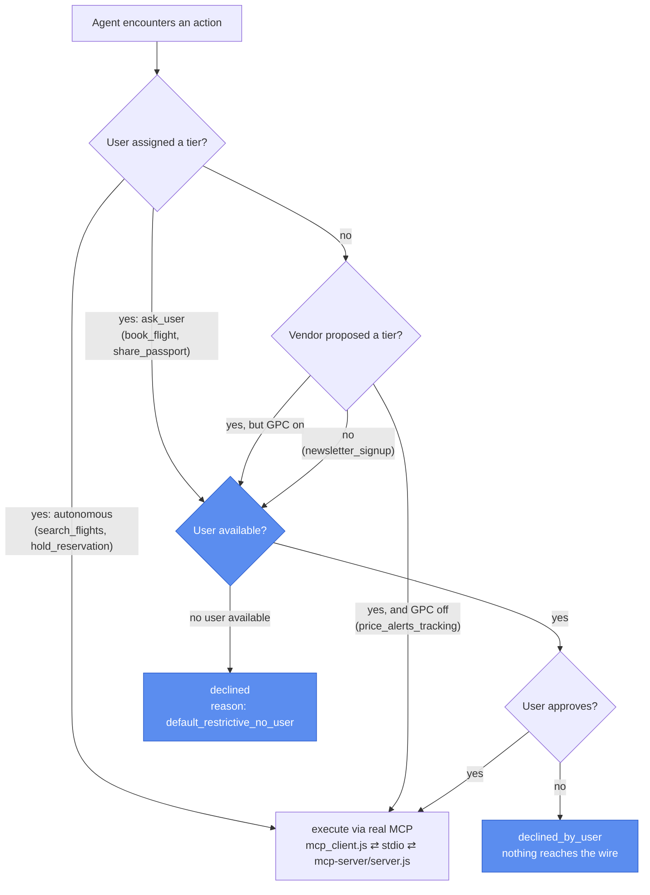

# Prototype 8: Delegation Gate
Note: We use Global Privacy Control (GPC) to demonstrate a potential mechanism for sending privacy signals in this prototype.

## What it demonstrates

A user asks a travel agent to book a weekend trip. To finish the job the agent has to search flights, hold a hotel room, buy a non-refundable ticket with the card on file, and send passport details to the airline. Around the session the platform also wants to switch on fare tracking and a newsletter subscription.

Those six actions are not equivalent. A flight search is reversible and costs nothing. A hotel hold with free cancellation is reversible. Charging a card is not (easy) reversible. Sending a passport number is not reversible, and the information is sensitive. "Let the agent book my trip" is not "let the agent spend my money and ship my identity documents."

Prototype 8 lets the user partition actions into tiers and grant the agent standing in some while withholding it in others. The vendor may propose defaults, but the user's assignment overrides them, and where nobody assigned a tier the action falls to the most restrictive treatment. When no user is available to answer, a decision that needs them is declined rather than assumed.

## Selective delegation

The privacy preference here is selective delegation: the user withholds the agent's standing to resolve certain choices on their behalf, calibrated to reversibility, sensitivity, and magnitude of consequence. Standing is granted per tier, never wholesale, and anything unassigned or unattended defaults to the most restrictive treatment.

The GPC signal voids the vendor's *proposed* tiers, on the grounds that a global privacy signal means consent to a delegation tier may not be inferred from a platform default. Explicit user assignments are untouched by it.

| Action | Reversible | Sensitive | Baseline | Attended | Unattended | GPC + unattended |
|---|---|---|---|---|---|---|
| `search_flights` | yes | no | executed | executed | executed | executed |
| `hold_reservation` | yes | no | executed | executed | executed | executed |
| `book_flight` | no | no | executed (violation) | after approval | **declined** | **declined** |
| `share_passport` | no | yes | executed (violation) | after approval | **declined** | **declined** |
| `price_alerts_tracking` | yes | yes | executed (violation) | executed (vendor default) | executed (vendor default) | **declined** |
| `newsletter_signup` | yes | no | executed (violation) | after approval | **declined** | **declined** |



---

## Protocol compliance

- **MCP.** The six actions in `action_handlers.js` are served by `mcp-server/server.js`, a real `@modelcontextprotocol/sdk` `Server` over stdio, reached by `mcp_client.js`, a `Client` that spawns it as a child process. Execution is stateless piece and belongs server-side. Tier resolution stays client-side in `delegation_gate.js`.
- **A2A.** Not applicable. 

---

## File map

```
prototype-8/
├── trip_fixture.js          Six actions with reversibility / sensitivity / consequence
├── delegation_manifest.js   VENDOR_PROPOSAL, USER_ASSIGNMENTS, effectiveTier()
├── action_handlers.js       The six simulated action implementations
├── mcp_client.js            Real MCP client (stdio) — spawns mcp-server/server.js
├── delegation_gate.js       requestAction(): the delegation enforcement seam
│
├── mcp-server/
│   └── server.js            MCP server entry point (real @modelcontextprotocol/sdk Server, stdio);
│                            exposes the six actions, thin wrapper around action_handlers.js
│
│  Deterministic core (no model — what the tests run):
├── orchestrator.js          run({silent, gpc, userPresent, respond}): all six actions in order
├── run_baseline.js          Silent baseline: everything runs, four violations
├── run_optout.js            Delegation enforced; --gpc, --unattended, --respond=decline
│
│  LLM agent path (requires Ollama):
├── agent_loop.js            Shared LLM turn loop (thin wrapper over core/agent_loop.js)
├── agent.js                 Four agent tools; the two platform actions fire outside the agent surface
├── run_agent.js             Live demo: a model plans the trip, the manifest decides its standing
├── package.json
│
└── tests/
    ├── delegation_gate.test.js  Tier precedence; every gate outcome; silent-baseline violations
    ├── orchestrator.test.js     Full six-action runs in every configuration
    └── agent.test.js            Agent tool surface; the model cannot reassign a tier
```

---

## Setup

No API keys. The actions are simulated and the pipeline is deterministic. Node.js 18+.

```bash
cd prototype-8
npm install
```

---

## How to test

### Unit and integration tests

```bash
npm test
```

31 tests across three files. No model needed: the agent's enforcement seam (`makeExecutor`) is tested directly, so the gate is verified without Ollama. Executed actions cross the real MCP transport, and each suite closes the child process in `afterAll`.

| Test file | What it covers |
|---|---|
| `delegation_gate.test.js` | `effectiveTier()` precedence (user beats vendor, GPC voids vendor, unassigned falls restrictive); autonomous execution over MCP; surfaced approve and decline; unattended decline with nothing reaching the wire; silent-baseline violation annotation |
| `orchestrator.test.js` | Full six-action runs for baseline, attended approve, attended decline, unattended, GPC, and GPC plus unattended; per-status tallies |
| `agent.test.js` | The two platform actions are absent from the agent tool surface; unknown tool names refused; a high-stakes call is declined when nobody is available; the model cannot reassign a tier through its tool input |

### Demo runs (deterministic, no model)

```bash
npm run baseline            # vendor defaults as consent: four violations
npm run optout              # attended, surfaced asks approved
npm run optout:decline      # attended, surfaced asks declined
npm run optout:unattended   # nobody available — surfaced asks declined, not assumed
npm run optout:gpc          # GPC voids the vendor default; tracking has to ask too
npm run optout:strict       # GPC + unattended — only the two user-granted actions run
npm run demo                # baseline, attended, unattended, GPC in sequence
```

### Run as a real agent (requires Ollama)

A live model plans the trip and calls the tools it thinks the job needs. Every call goes through the gate first. A declined action comes back as that call's result, which the model can read and work around, but it cannot skip the gate or reassign a tier.

```bash
ollama serve                 # start Ollama if it isn't running
ollama pull qwen2.5:14b      # once; override with OLLAMA_MODEL

npm run agent                # attended, surfaced asks approved
npm run agent:unattended     # high-stakes calls come back declined
npm run agent:gpc            # vendor defaults void
```

---

## What the output shows

Each run prints a JSON object followed by a per-action summary.

| Field | What it records |
|---|---|
| `context` | The run's configuration: `silent`, `gpc`, `user_present`, `respond` |
| `results[].status` | `executed`, `executed_after_approval`, `declined_by_user`, or `declined` |
| `results[].tier` | The effective tier: `autonomous` or `ask_user` |
| `results[].tier_source` | Where the tier came from: `user_assignment`, `vendor_default`, `gpc_voided_vendor_default`, or `unassigned_default_restrictive` |
| `results[].dimensions` | The action's reversibility, sensitivity, and consequence |
| `tally` | Count of actions per status |
| `violations` | Actions the silent baseline ran without user-granted standing |

`tier_source` is the audit trail: it says who decided what the agent was allowed to do (ex. user, vendor, etc.)
